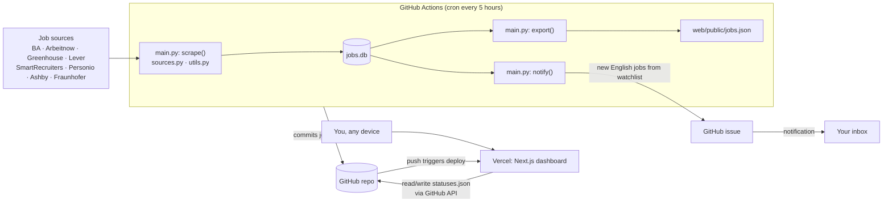

# Arbeit.watchdog

**Dashboard:** https://arbeit-watchdog.vercel.app/

## What it does

- **Collects jobs.** Every 5 hours it gathers Werkstudent and internship tech jobs in Germany from the Bundesagentur für Arbeit, Arbeitnow, about 80 company career pages and Fraunhofer. It removes duplicates and detects whether each job description is German or English.
- **Watches companies.** When a company in `data/watchlist.json` (for now only 1KOMMA5°) posts a new English-language job, it opens a GitHub issue. GitHub emails you about it, and each job in the issue has a direct apply link.
- **Shows a dashboard.** You can search and filter every job, and mark each one as `interesting`, `applied`, `interview`, `rejected` or `hidden` from any device.

## Architecture

| Part | File | Role |
| --- | --- | --- |
| Entry point | `watchdog/main.py` | Runs `scrape()`, `export()` and `notify()` in order. `scrape()` fetches jobs, keeps only Werkstudent/intern tech roles, removes duplicates, detects the language and stores the result in `data/jobs.db` (SQLite) |
| Sources | `watchdog/sources.py`, `data/companies.json` | One fetcher per job site or ATS |
| Watchdog | `notify()` in `main.py`, `data/watchlist.json` | Finds English jobs from watched companies that you haven't been notified about, opens an issue and records them in the `notified` table |
| Export | `export()` in `main.py` | Writes `data/jobs.db` to `web/public/jobs.json` for the dashboard |
| Helpers | `watchdog/utils.py` | Relevance, level and language filters, HTML stripping, dedupe keys |
| Scheduler | `.github/workflows/scrape.yml` | Runs `python -m watchdog.main` and commits `data/jobs.db` and `jobs.json` |
| Dashboard | `web/` (Next.js + TypeScript on Vercel) | A static page that reads `jobs.json`. `app/api/statuses` reads and writes `data/statuses.json` in this repo through the GitHub API, and writing needs the passphrase |

All data lives in `data/`: `jobs.db` (SQLite), `companies.json`, `watchlist.json` and `statuses.json`. The only exception is `web/public/jobs.json`, which has to sit in the dashboard's public folder so Vercel can serve it.

**Why it's built this way:** the database is a file in git, so it needs no server and no database service. Statuses are kept in their own `data/statuses.json` so they never conflict with the bot's commits to `data/jobs.db`. Commits that only change statuses don't trigger a Vercel rebuild (`web/vercel.json`).

### Configuration

- **GitHub Actions:** no secrets needed. It uses the built-in `GITHUB_TOKEN`.
- **Vercel** (Root Directory `web`):
  - `GITHUB_TOKEN`: a fine-grained token with Contents read/write on this repo
  - `GITHUB_REPO`: `ktr-workers/Arbeit.watchdog`
  - `SAVE_PASSPHRASE`: the passphrase needed to save statuses

To run everything locally, use `.venv/bin/python -m watchdog.main` from the repo root. Notifying is skipped when `GITHUB_TOKEN` isn't set. To run the dashboard locally, use `cd web && npm run dev`.

## Roadmap: towards an apply loop

The aim is a loop of **find → shortlist → prepare → apply → track**, where you only step in where a person has to. Most application forms (Personio included) are protected by a CAPTCHA and ask questions specific to each job. The last click therefore stays with you, and everything before and after it can be automated.

1. **Better finding**
   - Check watchlist companies every hour, using a lightweight check of their feed only.
   - Add a watchlist editor to the dashboard, and add more sources such as Workday, Join and StepStone.
   - Mark a job as closed when it disappears from its source.
2. **Shortlisting**
   - Score each job against your CV with an LLM (Claude API) and show the score on the dashboard.
   - Notify you only above a threshold, and include a short summary of why the job fits.
3. **Preparing applications**
   - Keep a profile file (`profile.json`) with answers to the usual questions: salary expectation, start date, German level, study duration, work permit.
   - Generate a tailored cover letter and CV variant for each job and attach them to the issue or the dashboard.
   - Add an "Apply" button that opens the form already filled in, using a browser extension or Playwright. It stops before submitting so you can solve the CAPTCHA and check the details.
4. **Applying through official APIs, where they exist**
   - Some ATS platforms offer candidate application endpoints. Use them only where they are publicly allowed and protected by neither a CAPTCHA nor a company-only API key.
5. **Tracking**
   - Read replies in your Gmail, such as rejections and interview invitations, and update statuses automatically.
   - Send follow-up reminders after N days without an answer, and show weekly stats on the dashboard.
   - Close the watchdog issue automatically when every job in it has a status.
